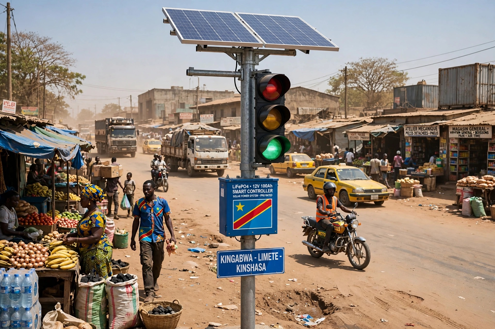

# 🚦 Kinshasa Smart Traffic Light
### Feu de Circulation Solaire Intelligent - Grande Voie Kinshasa

> 100% solaire | Contrôlé par téléphone 4G | Open Source | Made in Congo 🇨🇩

### 📍  Kinshasa
Feu solaire installé à Kingabwa, route poussiéreuse avec camions, taxis jaunes, marché. **Pas de SNEL? Pas de problème!** Notre système fonctionne 72h sans soleil.

**Prochain site:** Gombe - Boulevard du 30 Juin (grande voie 6m)

## 🎯 Le Problème / The Problem
Les grandes routes de Kinshasa (Blvd 30 Juin, Triomphal, Matadi) n'ont pas de feux ou feux cassés. Résultat: embouteillages monstres, accidents, pas de régulation.

## 💡 La Solution
- 2x Panneaux solaires 100W = 200W total
- Batterie LiFePO4 12V 100Ah = **72h sans soleil**
- Contrôleur Raspberry Pi 4 + 4G Airtel/Vodacom/Orange
- Contrôle depuis téléphone via Telegram
- Poteau 6 mètres + Boîtier IP65
- Coût: $370 à $900 vs $27,500 ancien robot!

## 🛒 Où acheter à Kinshasa
Marché Gambela / Zando / Limete 7ème rue / Jumia RDC

## 💻 Code
Dans `firmware/traffic_controller.py`

Made with ❤️ in Kinshasa - blackdolph12
